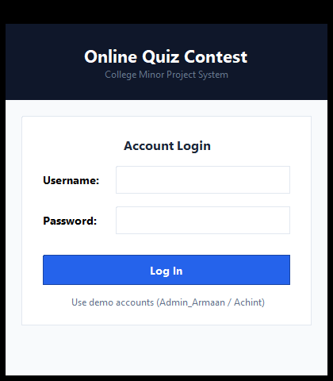
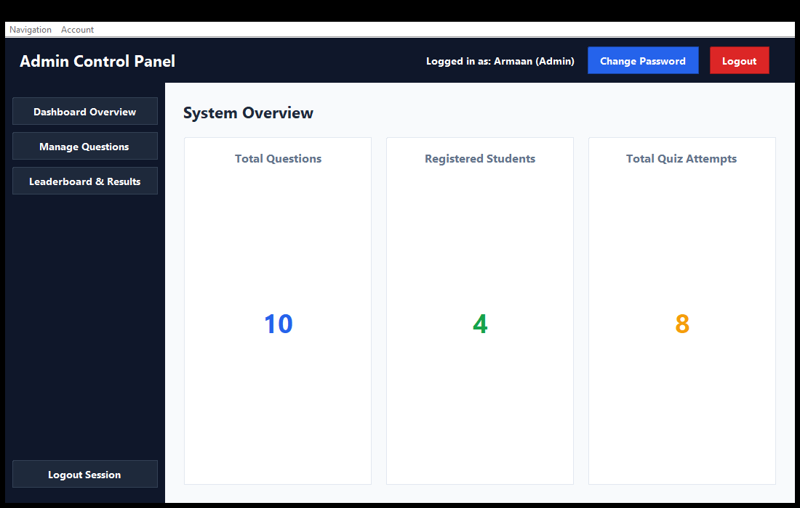
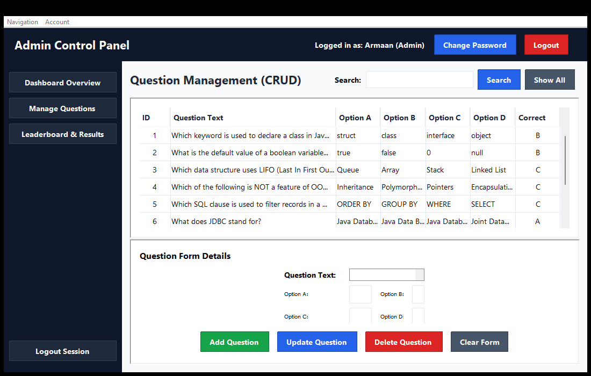
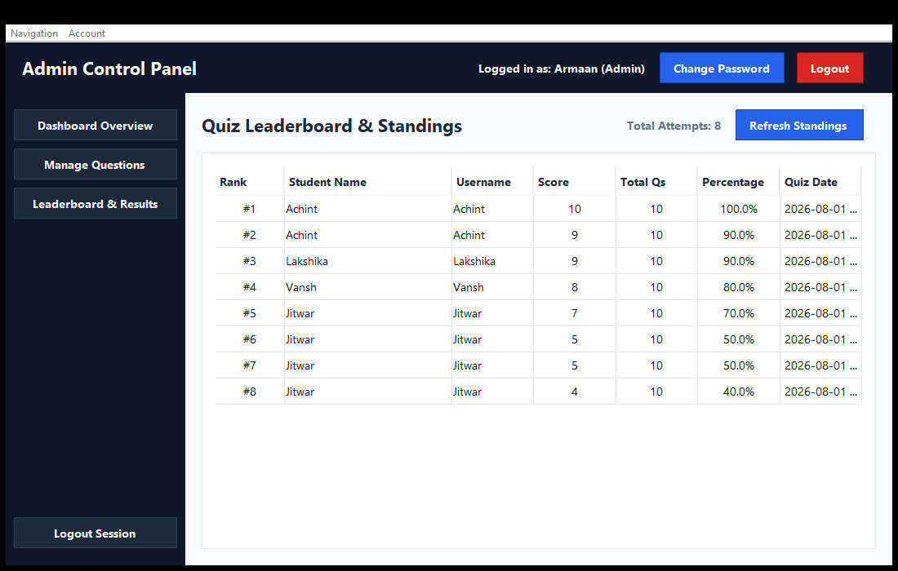
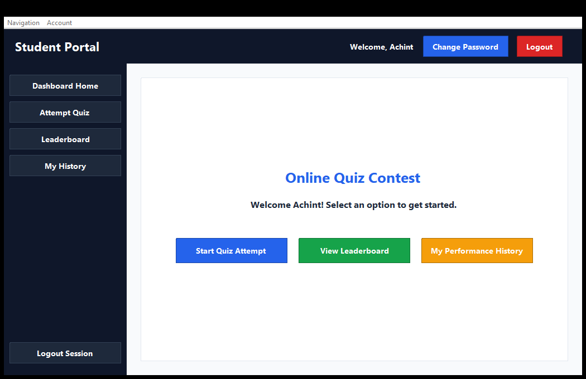
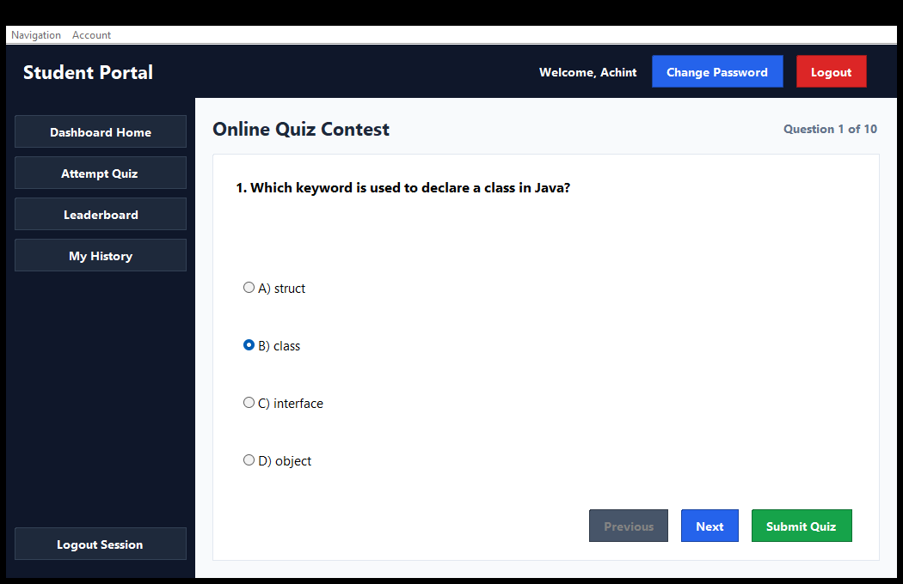
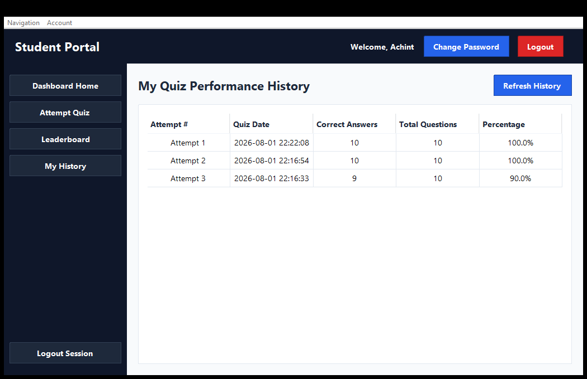
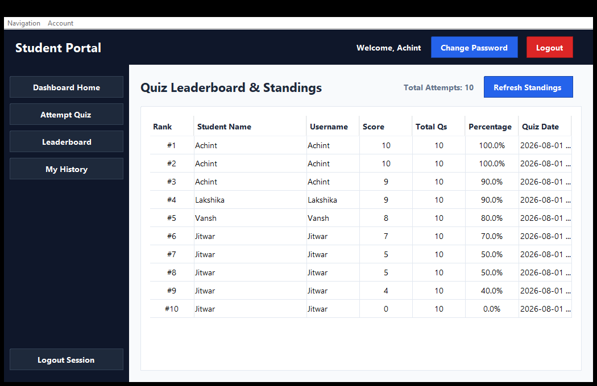
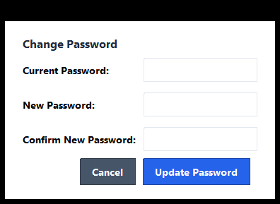

# Online Quiz Contest & Leaderboard System

A desktop-based management system developed in **Java**, **Java Swing**, **JDBC**, and **MySQL** as an academic Minor Project (NSP) for B.Tech II Year – III Semester.

The system provides dual-role authentication (Admin & Student), question management (CRUD), interactive quiz attempts with per-question answer preservation, score calculation, leaderboard standings, performance history, and account password management.

---

## Project Information

- **Project Title:** Online Quiz Contest & Leaderboard System
- **Course:** Minor Project Lab (NSP)
- **Program:** B.Tech – Computer Science Engineering (CSE)
- **Semester:** III Semester
- **Institution:** Poornima Institute of Engineering & Technology (PIET)
- **Student Name:** Mohd Armaan Tak
- **Student ID:** PIET25CR035

---

## Technology Stack

- **Core Language:** Java (JDK 8+ / 17+ / 26 compatible)
- **GUI Framework:** Java Swing (`JFrame`, `JPanel`, `JTable`, `CardLayout`, `JOptionPane`)
- **Database:** MySQL 8.0+ / MariaDB
- **Database Connectivity:** JDBC (`mysql-connector-j`)
- **Development Environment:** IntelliJ IDEA

---

## Features

### Admin Module
- **Admin Login:** Secure authentication as system administrator (`ADMIN` role).
- **Dashboard Overview:** Real-time statistics displaying Total Questions, Registered Students, and Total Quiz Attempts.
- **Question Management (CRUD):**
  - **Create:** Add new multiple-choice questions with 4 options and correct option specification.
  - **Read:** Display all questions in a styled, scrollable `JTable`.
  - **Search:** Search questions dynamically by Question ID or Question Text.
  - **Update:** Select table rows to populate form details and modify question data.
  - **Delete:** Delete questions with a modal confirmation dialog.
- **Leaderboard & Results:** View complete student quiz performance rankings.
- **Change Password & Logout:** Password update dialog and session logout.

### Student Module
- **Student Login:** Authenticate using pre-seeded student user accounts (`USER` role).
- **Student Dashboard:** Quick access to start quiz attempts, view standings, or check history.
- **Attempt Quiz:**
  - Interactive multiple-choice question layout using radio buttons.
  - Question navigation (Previous & Next) with question counter progress.
  - **Per-question Answer Preservation:** Selected answers are independently preserved when navigating back and forth.
- **Score Calculation & Persistence:** Computes total correct answers and percentage upon submission, automatically saving the result to MySQL.
- **Quiz History & Leaderboard:** View personal attempt history and overall student leaderboard ranks.
- **Change Password & Logout.**

### Common Functionality
- Role-based access control (Admin vs Student).
- Database operations using JDBC `PreparedStatement`.
- Form validation preventing empty fields and invalid inputs.
- `JTable` visual presentation with custom cell renderers.
- Exception handling for database offline scenarios.
- High-contrast visual styling for UI buttons.

---

## Screenshots

### 1. Login Screen


### 2. Admin Dashboard


### 3. Question Management (CRUD & Search)


### 4. Admin Leaderboard & Standings


### 5. Student Dashboard


### 6. Attempt Quiz Interface


### 7. Quiz Result Summary


### 8. Student Performance History


### 9. Student Leaderboard


### 10. Change Password Dialog


---

## Database Design

The project uses a minimal MySQL database named `quiz_db` comprising three core tables:

1. **`users`**
   - `user_id` (INT, Primary Key, Auto Increment)
   - `username` (VARCHAR(50), Unique, Not Null)
   - `password` (VARCHAR(100), Not Null)
   - `full_name` (VARCHAR(100), Not Null)
   - `role` (ENUM('ADMIN', 'USER'), Default 'USER')
   - `created_at` (TIMESTAMP)

2. **`questions`**
   - `question_id` (INT, Primary Key, Auto Increment)
   - `question_text` (TEXT, Not Null)
   - `option_a`, `option_b`, `option_c`, `option_d` (VARCHAR(255), Not Null)
   - `correct_option` (CHAR(1), Not Null)

3. **`results`**
   - `result_id` (INT, Primary Key, Auto Increment)
   - `user_id` (INT, Foreign Key -> `users.user_id` ON DELETE CASCADE)
   - `score` (INT, Not Null)
   - `total_questions` (INT, Not Null)
   - `percentage` (DOUBLE, Not Null)
   - `quiz_date` (TIMESTAMP)

---

## Project Structure

```
Online-Quiz-Contest-Leaderboard-System/
├── schema.sql                     -- Database creation and sample seed script
├── README.md                      -- Project documentation and execution guide
├── .gitignore                     -- Git ignore rules
├── screenshots/                   -- Application screenshots
└── src/
    ├── database/
    │   └── DBConnection.java      -- JDBC MySQL connection class
    ├── model/
    │   ├── User.java              -- User model POJO
    │   ├── Question.java          -- Question model POJO
    │   └── Result.java            -- Result model POJO
    ├── dao/
    │   ├── UserDAO.java           -- Database CRUD for user authentication
    │   ├── QuestionDAO.java       -- Database CRUD for question management
    │   └── ResultDAO.java         -- Database operations for quiz results & leaderboard
    ├── ui/
    │   ├── UIStyle.java           -- Theme colors, fonts, and button styling
    │   ├── LoginFrame.java        -- Login frame
    │   ├── AdminDashboardFrame.java-- Admin dashboard and navigation
    │   ├── UserDashboardFrame.java -- Student dashboard and navigation
    │   ├── ManageQuestionsPanel.java-- Question CRUD panel
    │   ├── AttemptQuizPanel.java  -- Interactive quiz taking panel
    │   ├── LeaderboardPanel.java  -- Leaderboard display panel
    │   ├── ViewResultsPanel.java  -- Quiz history panel
    │   └── ChangePasswordDialog.java-- Password update dialog
    └── Main.java                  -- Application launcher
```

---

## Prerequisites

Before running the application, ensure you have installed:

- **JDK 8 or higher** (Java 17+ or 26 recommended)
- **MySQL Server 8.0+** (or MariaDB)
- **IntelliJ IDEA** (Community or Ultimate Edition)
- **MySQL Connector/J** (`mysql-connector-j-8.3.0.jar` or similar JDBC driver)

---

## Database Setup

1. Start your local MySQL Server instance.
2. Open MySQL Workbench or MySQL Command Line Client.
3. Import and execute `schema.sql`:
   ```sql
   SOURCE /path/to/schema.sql;
   ```
4. Confirm that the `quiz_db` database is created along with tables `users`, `questions`, and `results`.
5. Open `src/database/DBConnection.java` and configure your database settings:
   ```java
   private static final String URL = "jdbc:mysql://localhost:3306/quiz_db?useSSL=false&allowPublicKeyRetrieval=true&serverTimezone=UTC";
   private static final String USER = "root";
   private static final String PASSWORD = "YOUR_MYSQL_PASSWORD"; // Set your local password
   ```

---

## Add MySQL JDBC Driver in IntelliJ IDEA

To add the JDBC driver dependency in IntelliJ IDEA:

1. Download `mysql-connector-j-8.3.0.jar` (or equivalent).
2. Open the project in IntelliJ IDEA.
3. Go to **File -> Project Structure -> Modules**.
4. Select the **Dependencies** tab.
5. Click **+ (Add)** -> **JARs or directories...**.
6. Select your downloaded `mysql-connector-j-8.3.0.jar` file.
7. Click **Apply** and **OK**.

---

## How to Run

1. Clone or download this repository:
   ```bash
   git clone https://github.com/USERNAME/online-quiz-contest-leaderboard-system.git
   ```
2. Open the project folder in **IntelliJ IDEA**.
3. Configure the JDK under **File -> Project Structure -> Project SDK**.
4. Add the MySQL Connector/J JAR as described above.
5. Execute `schema.sql` in MySQL.
6. Set your local MySQL password in `src/database/DBConnection.java`.
7. Run `src/Main.java`.

---

## Demo Login Credentials

The `schema.sql` script pre-seeds the database with demo accounts:

| Role | Username | Password | Full Name |
| :--- | :--- | :--- | :--- |
| **ADMIN** | `Admin_Armaan` | `admin123` | Armaan |
| **STUDENT** | `Achint` | `user123` | Achint |
| **STUDENT** | `Vansh` | `user123` | Vansh |
| **STUDENT** | `Jitwar` | `user123` | Jitwar |
| **STUDENT** | `Lakshika` | `user123` | Lakshika |

---

## Application Flow

### Admin Flow
```
Login -> Dashboard Overview -> Manage Questions (CRUD & Search) -> Leaderboard -> Change Password -> Logout
```

### Student Flow
```
Login -> Dashboard -> Attempt Quiz -> Submit Quiz -> Score Summary -> History / Leaderboard -> Logout
```

---

## Project Objectives

- Implement a GUI-based desktop application using Java Swing.
- Establish relational database communication using JDBC and MySQL.
- Perform Create, Read, Update, Delete (CRUD) operations on database records.
- Implement input validation and exception handling.
- Maintain clean, modular architecture suitable for B.Tech Minor Project evaluation.

---

## Notes

- Ensure MySQL Server is running before launching `Main.java`.
- Set your local database password in `DBConnection.java` prior to execution.
- `schema.sql` contains default seed questions and sample results for demonstration.
